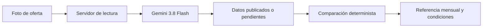
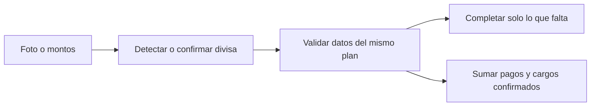
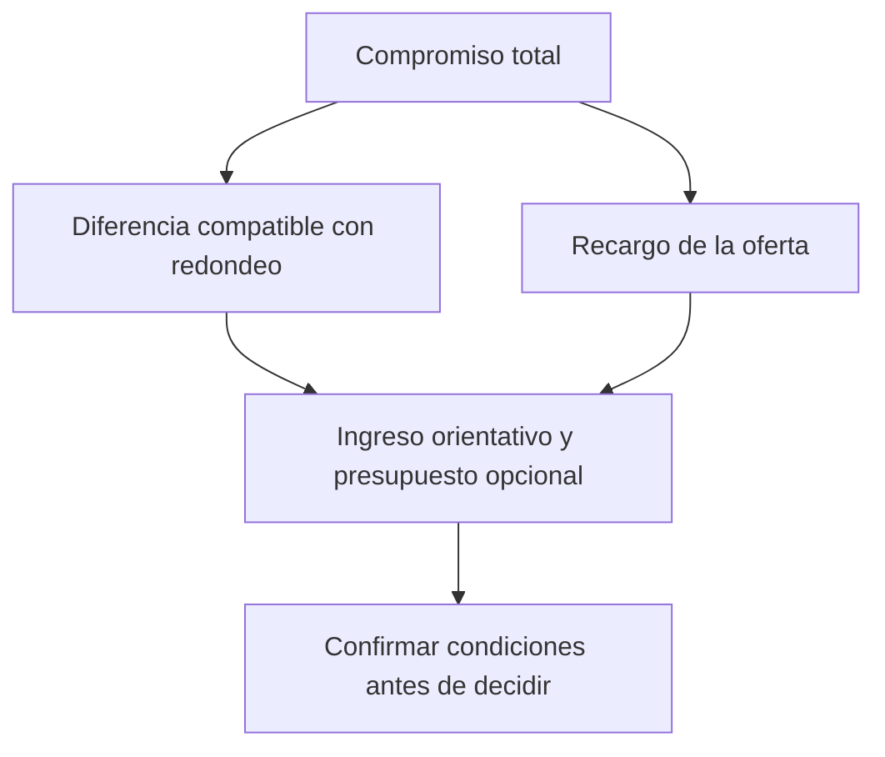

# Cuotas — Entiende tu compromiso de pago

Lee una oferta comercial en foto o recibe montos manuales para comparar el compromiso de pago en Guatemala, Colombia y Panamá. Muestra primero una referencia mensual orientativa con supuestos editables; no aprueba créditos ni garantiza capacidad de pago. Las condiciones ausentes quedan marcadas como pendientes de confirmar.

- [Aplicación en vivo](https://cuotas-auditor-gt.web.app/) · [Guía rápida](https://cuotas-auditor-gt.web.app/?guia=1) · [Dar opinión](https://cuotas-auditor-gt.web.app/?feedback=1)
- [Arquitectura técnica y modelo matemático](docs/ARCHITECTURE.md)







## Desarrollo y verificación

```sh
npm install
npm test
npm run build
npm run dev
```

La suite ejecuta pruebas unitarias del motor determinista (`src/engine/offerConsultant.ts`, `src/engine/budgetDecision.ts`, `src/engine/creditAudit.ts`) e integración HTTP con respuestas parciales y regionales.
